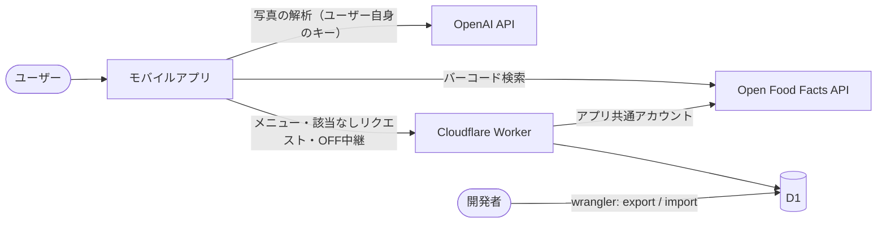

# アーキテクチャ

栄養管理モバイルアプリ（React Native、まず Android）の全体構成。English version: [Architecture.md](Architecture.md)

## システム構成



## データの置き場所

| データ                             | 場所                              | 理由                                       |
| ---------------------------------- | --------------------------------- | ------------------------------------------ |
| 日誌・マイ食品・お気に入り・目標   | 端末（expo-sqlite / MMKV）        | ユーザーごとのデータでサーバー不要         |
| 文部科学省 食品成分表              | アプリに同梱（読み取り専用 SQLite） | 数MBの固定データ                           |
| ユーザーの OpenAI API キー         | 端末（expo-secure-store、Keystore） | ユーザーが用意する。当サーバーには送らない |
| OpenAI のモデル名などの設定        | 端末（MMKV）                        | 秘密情報ではない                           |
| チェーン店メニューの栄養価         | サーバー（D1）                    | 全ユーザーで共有。登録は開発者のみ         |
| 該当なしリクエスト                 | サーバー（D1）                    | 開発者の手動バッチ用に蓄積                 |
| OFF 共通アカウントのパスワード     | Worker の secret                  | アプリに入れてはいけない                     |

## サーバーの責務

1. チェーン店メニューを返す（クライアントからは読み取りのみ）
2. 該当なしリクエストを記録する（追記・件数加算のみ）
3. 共通アカウントで Open Food Facts へ商品情報の提供を中継する

## 技術スタック

- アプリ: React Native + Expo（development build）, TypeScript（strict）, Expo Router, expo-sqlite + Drizzle ORM, react-native-mmkv, expo-secure-store, expo-camera（バーコード読み取りと撮影）, expo-background-task（同期）, TanStack Query, Zustand, react-native-gifted-charts, i18next + expo-localization, Jest + React Native Testing Library
- 共通: `Shared` パッケージ（Zod スキーマ、正規化、栄養素の型）をアプリとサーバーで共有する
- サーバー: TypeScript, pnpm, Cloudflare Workers 上の Hono, D1, Zod, Vitest（`@cloudflare/vitest-pool-workers`）, wrangler
- LLM: OpenAI API（画像対応の安価なモデル。ユーザーが選択可能。Structured Outputs）。`LlmClient` インターフェースの背後に置く

## リポジトリ構成

```
/App       React Native（Expo）アプリ
/Server    Cloudflare Worker
/Shared    アプリとサーバーで共有する型・Zod スキーマ・正規化
/Docs      システム文書（英語が主、*.ja.md が副）
```

`App`・`Server`・`Shared` は 1 つの pnpm ワークスペースにする。命名は CLAUDE.md に従う（自前のディレクトリ・ファイルは UpperCamelCase）。ツールが固定している名前（`package.json`、`app.json`、Expo Router の `app/` ディレクトリ、`en.json` などのロケールファイル）は慣例どおりにする。

## 費用

| 項目                   | 費用            | 備考                                                     |
| ---------------------- | --------------- | -------------------------------------------------------- |
| Cloudflare Workers, D1 | 0円（無料枠）   | 1日10万リクエスト。1リクエスト10msのCPU（中継はI/O中心） |
| Open Food Facts        | 0円             | 無料・APIキー不要（User-Agent は必須）                   |
| OpenAI API             | ユーザー負担    | ユーザー自身のキー                                       |
| Google Play 開発者登録 | 一回限り 25ドル | 公開するときのみ                                         |

D1 の無料枠の上限は、公開前に公式ドキュメントで確認すること。

## 開発ツール

- フォーマッタ: TS・MD・JSON・YAML は Prettier（インデント2）、TS の静的解析は ESLint
- ローカライズ: i18next、`en.json`（既定）と `ja.json`
- 秘密情報: Worker は `wrangler secret`、ローカルは `.env`（git 管理外、`.env.example` を用意）
