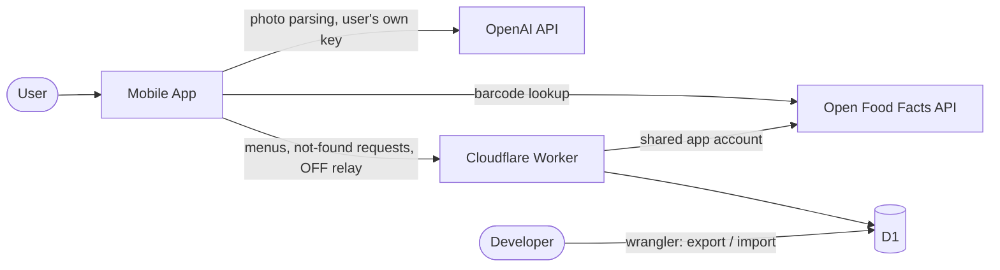

# Architecture

Overall system architecture of the nutrition tracking mobile app (React Native, Android first). Japanese version: [Architecture.ja.md](Architecture.ja.md)

## System Context



## Where Data Lives

| Data                              | Location                                    | Why                                                |
| --------------------------------- | ------------------------------------------- | -------------------------------------------------- |
| Diary, my foods, favorites, goals | Device (expo-sqlite)                        | Per-user data, no server needed                    |
| MEXT food composition table       | Bundled in the app (JSON, in-memory search) | Fixed data of a few MB                             |
| User's OpenAI API key             | Device (expo-secure-store, Keystore)        | The user provides it; never sent to our server     |
| OpenAI model name, other settings | Device (kv-store; localStorage on web)      | Not secret                                         |
| Chain menu nutrition              | Server (D1)                                 | Shared by all users, entered by the developer only |
| Not-found requests                | Server (D1)                                 | Collected for the developer's manual batch         |
| OFF shared account password       | Worker secret                               | Must not ship in the app                           |

## Server Responsibilities

1. Return chain menus (read-only for clients).
2. Record not-found requests (append / count up only).
3. Relay product contributions to Open Food Facts using the shared app account.

## Tech Stack

- App: React Native + Expo (development builds), TypeScript (strict), Expo Router, expo-sqlite (data and kv-store), expo-secure-store, expo-camera (barcode scanning), expo-image-picker and expo-image-manipulator (photos), expo-background-task (sync), i18next + expo-localization, Jest + React Native Testing Library
- Shared: a `Shared` package (Zod schemas, normalization, nutrient types) used by both App and Server
- Server: TypeScript, pnpm, Hono on Cloudflare Workers, D1, Zod, Vitest (`@cloudflare/vitest-pool-workers`), wrangler
- LLM: OpenAI API (cheap vision-capable model, user selectable, Structured Outputs) behind an `LlmClient` interface

## Repository Layout

```
/App       React Native (Expo) app
/Server    Cloudflare Worker
/Shared    Types, Zod schemas and normalization shared by App and Server
/Docs      System documents (English primary, *.ja.md secondary)
```

`App`, `Server` and `Shared` form one pnpm workspace. Naming follows CLAUDE.md (UpperCamelCase for our own directories and files). Paths and names fixed by tools (`package.json`, `app.json`, Expo Router's `app/` directory, locale files such as `en.json`) keep their conventional form.

## Cost

| Item                   | Cost          | Note                                                          |
| ---------------------- | ------------- | ------------------------------------------------------------- |
| Cloudflare Workers, D1 | 0 (free tier) | 100k requests/day; 10 ms CPU per request (relay is I/O-bound) |
| Open Food Facts        | 0             | Free, no API key (User-Agent required)                        |
| OpenAI API             | User pays     | The user's own key                                            |
| Google Play developer  | One-time $25  | Only when publishing                                          |

D1 free-tier quotas must be confirmed in the official documentation before launch.

## Tooling

- Formatters: Prettier (2-space indent) for TS, MD, JSON, YAML; ESLint for TS
- Localization: i18next with `en.json` (default) and `ja.json`
- Secrets: Worker secrets via `wrangler secret`; local values in `.env` (git-ignored, with `.env.example`)
