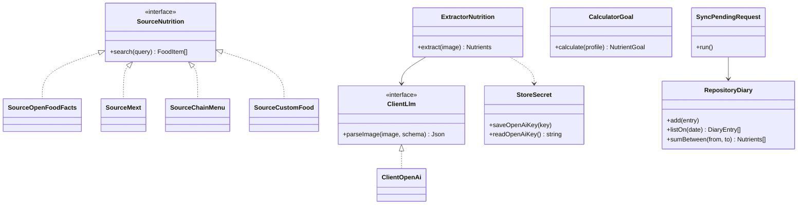
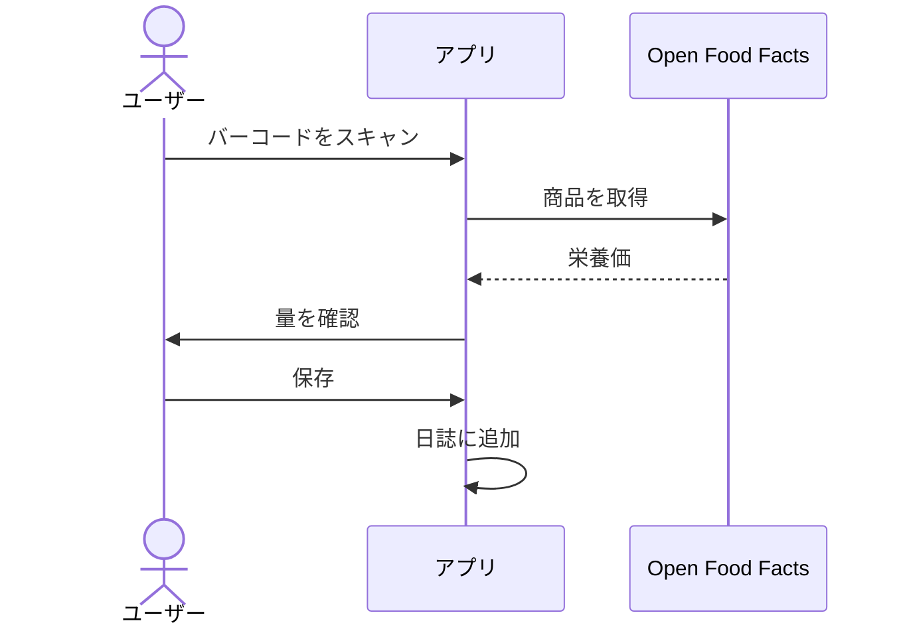
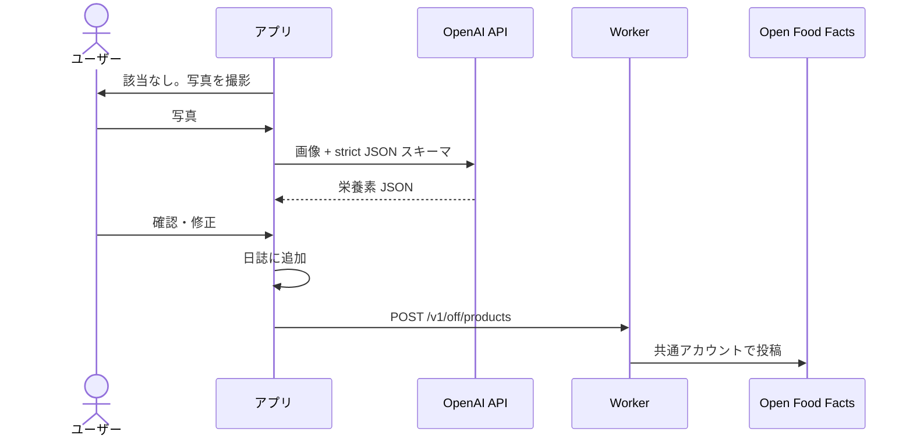
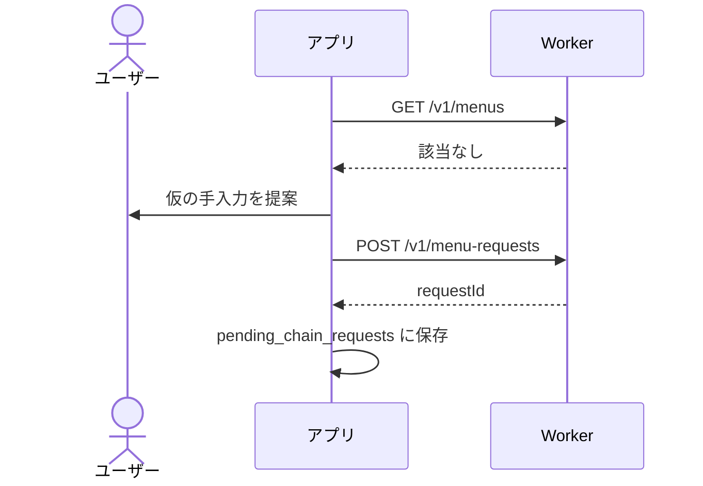
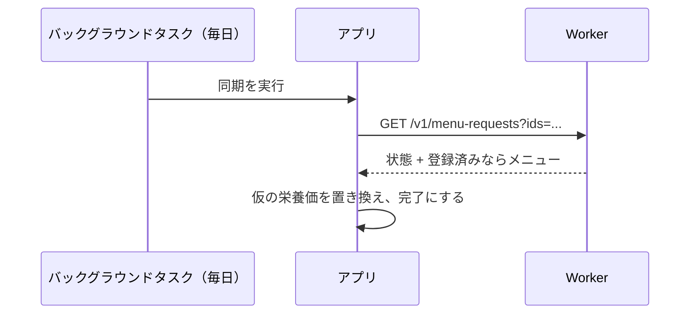

# モバイルアプリ設計

React Native（Expo）アプリ。まず Android 向け。English version: [MobileAppDesign.md](MobileAppDesign.md)

## MVP の範囲

目標値設定と日次集計、マイ食品・お気に入り・履歴、週・月のグラフ。体重記録は含めない。

## レイヤー

`ui`（Expo Router の画面、小さなコンポーネント、hooks）→ `domain`（ユースケース、モデル、リポジトリのインターフェース）→ `data`（Drizzle 経由の expo-sqlite、外部 API、リポジトリ実装）

クラス名は CLAUDE.md に従う（主となる名詞を先頭に置く。例: `SourceOpenFoodFacts`、`ClientLlm`）。

## クラス図

### Nutrients（栄養素）

MVP の基本セット: エネルギー(kcal)、たんぱく質、脂質、炭水化物、食物繊維、食塩相当量。100 g あたりと 1 食分あたりで保持する。型と Zod スキーマは `Shared` パッケージに置く。

## ローカル DB（expo-sqlite、Drizzle）

| テーブル                 | カラム                                                                                         |
| ------------------------ | ---------------------------------------------------------------------------------------------- |
| `food_items`             | id, source（OFF / MEXT / CHAIN / CUSTOM / MANUAL）, source_ref, name, brand, 栄養素, 1食分の量 |
| `diary_entries`          | id, date, meal_type, food_item_id?, pending_request_id?, 量, 栄養素のスナップショット          |
| `favorites`              | food_item_id, created_at                                                                       |
| `pending_chain_requests` | id, server_request_id, chain_name, menu_name, status                                           |

文部科学省データは別の読み取り専用 DB とし、アセット（expo-asset）として同梱して、初回起動時にドキュメントディレクトリへコピーする。プロフィール・目標・設定は MMKV、OpenAI キーは expo-secure-store に保存する。

## 目標値

- 基礎代謝量は日本人の食事摂取基準（2025年版）に沿い、Ganpule の式 × 身体活動レベルで求める。
- PFC のエネルギー比の初期値: たんぱく質 13〜20%、脂質 20〜30%、炭水化物 50〜65%。
- ユーザーはどの目標値も上書きできる。

## 画面（Expo Router）

今日（集計と目標の比較）/ 食品追加（バーコード、文科省・チェーン店・マイ食品の検索、写真、手入力）/ 食品詳細と量 / 履歴グラフ（週・月）/ マイ食品・お気に入り / 設定（プロフィール、目標、OpenAI キーとモデル、言語）

## シーケンス

### 1. バーコード検索

### 2. OFF に商品がない場合

OpenAI キーがない場合は解析を無効にし、理由を UI に表示する。手入力は引き続き使える。

### 3. チェーン店メニューがない場合

### 4. 保留リクエストの同期

バックグラウンドタスクの実行時刻は保証されないため、アプリ起動時にも同期を行う。

### 5. 文部科学省データの検索

アプリ同梱の文科省 DB を名前で検索し、該当する食品を表示する。量はグラム単位で入力する。

## セキュリティ

- OpenAI キーは expo-secure-store（Android Keystore）に保存し、ログと、永続化するクエリキャッシュには含めない。
- サーバー呼び出しには、レート制限用のインストール ID（ランダムな UUID）を付ける。
