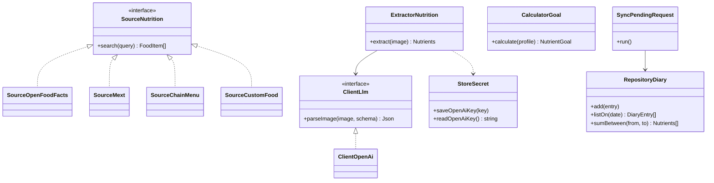
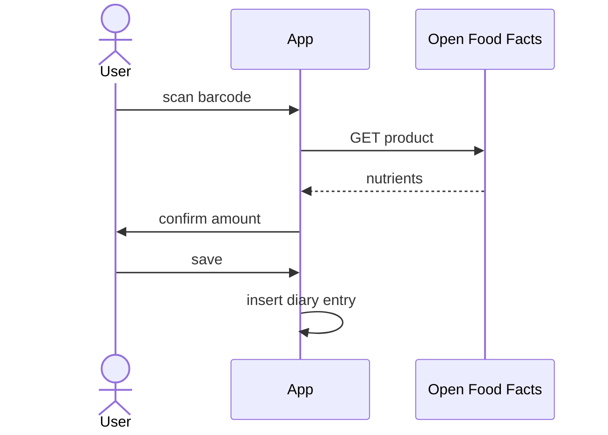
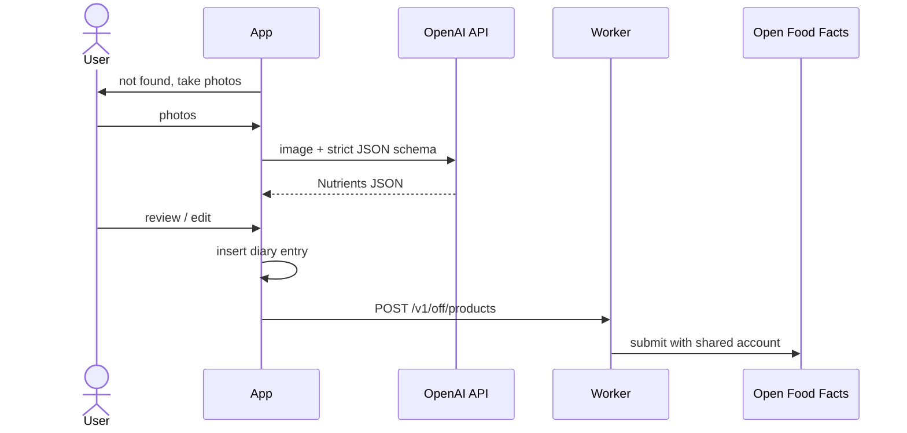
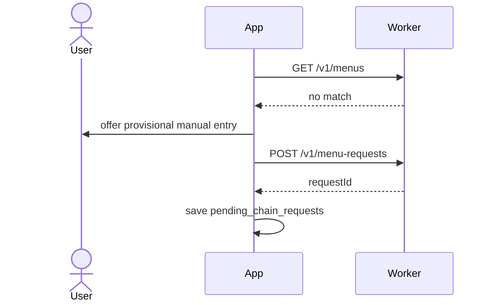
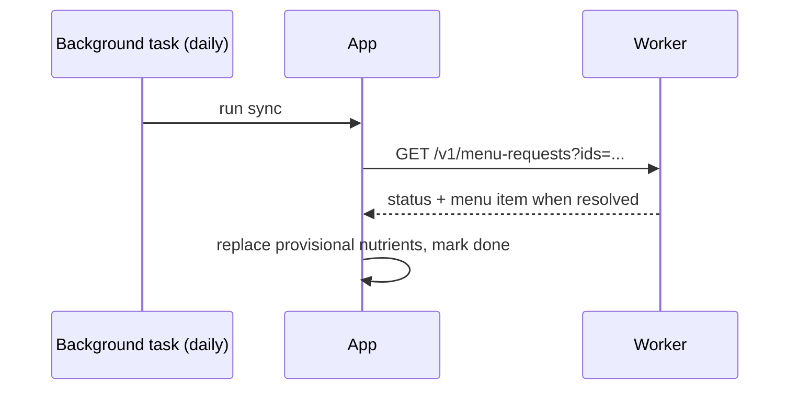

# Mobile App Design

React Native (Expo) app, Android first. Japanese version: [MobileAppDesign.ja.md](MobileAppDesign.ja.md)

## MVP Scope

Goals and daily totals, my foods / favorites / history, weekly and monthly charts. Weight logging is not included.

## Layers

`ui` (Expo Router screens, small components, hooks) → `domain` (use cases, models, repository interfaces) → `data` (expo-sqlite via Drizzle, remote APIs, repository implementations)

Class names follow CLAUDE.md (head noun first, e.g. `SourceOpenFoodFacts`, `ClientLlm`).

## Class Diagram

### Nutrients

MVP core set: energy (kcal), protein, fat, carbohydrate, dietary fiber, salt equivalent. Stored per 100 g and per serving. The type and its Zod schema live in the `Shared` package.

## Local Database (expo-sqlite, Drizzle)

| Table                    | Columns                                                                                             |
| ------------------------ | --------------------------------------------------------------------------------------------------- |
| `food_items`             | id, source (OFF / MEXT / CHAIN / CUSTOM / MANUAL), source_ref, name, brand, nutrients, serving size |
| `diary_entries`          | id, date, meal_type, food_item_id?, pending_request_id?, amount, nutrients snapshot                 |
| `favorites`              | food_item_id, created_at                                                                            |
| `pending_chain_requests` | id, server_request_id, chain_name, menu_name, status                                                |

The MEXT table is a separate read-only database bundled as an asset (expo-asset) and copied to the document directory on first launch. Profile, goals and settings are stored in MMKV; the OpenAI key is stored in expo-secure-store.

## Goals

- BMR from the Ganpule formula × activity level, following Dietary Reference Intakes for Japanese (2025 edition).
- Default PFC energy ratios: protein 13–20%, fat 20–30%, carbohydrate 50–65%.
- The user can override any target.

## Screens (Expo Router)

Today (totals vs goals) / Add food (barcode, search MEXT, chain and my foods, photo, manual) / Food detail and amount / History charts (week, month) / My foods and favorites / Settings (profile, goals, OpenAI key and model, language)

## Sequences

### 1. Barcode lookup

### 2. Product not found in OFF

Without an OpenAI key, the parsing step is disabled and the UI explains why; manual entry still works.

### 3. Chain menu not found

### 4. Pending request sync

The sync also runs on app start, because background task timing is not guaranteed.

### 5. MEXT search

The app queries the bundled MEXT database by name and shows the matching foods; amounts are entered in grams.

## Security

- The OpenAI key is stored with expo-secure-store (Android Keystore), kept out of logs and out of the persisted query cache.
- An installation ID (random UUID) is sent with server calls for rate limiting.
