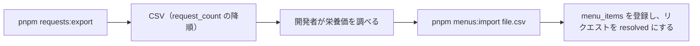

# サーバー設計

Cloudflare Worker（Hono + D1）。English version: [ServerDesign.md](ServerDesign.md)

## 責務

1. 開発者が登録したチェーン店メニューを返す。
2. 該当なしリクエストを記録する（集約して件数を数える）。
3. アプリ共通アカウントで Open Food Facts への商品情報の提供を中継する（パスワードは Worker の secret）。

クライアントはメニューデータを書き込めない。メニューは開発者が手動で登録する。

## API（`/v1`、JSON、Zod で検証）

| メソッド | パス                     | 目的                                                                  |
| -------- | ------------------------ | --------------------------------------------------------------------- |
| GET      | `/v1/chains`             | チェーン店の一覧                                                      |
| GET      | `/v1/menus?chain=&q=`    | メニューの検索                                                        |
| POST     | `/v1/menu-requests`      | 該当なしリクエストを記録し `{requestId}` を返す。同一のものは集約する |
| GET      | `/v1/menu-requests?ids=` | リクエストの状態。登録済みならメニューも返す                          |
| POST     | `/v1/off/products`       | 商品情報を OFF へ中継                                                 |
| POST     | `/v1/off/images`         | 商品写真を OFF へ中継                                                 |

POST にはインストール ID のヘッダーが必須で、レート制限がかかる。

## D1 スキーマ

| テーブル        | カラム                                                                                                                                                 |
| --------------- | ------------------------------------------------------------------------------------------------------------------------------------------------------ |
| `chains`        | id, name, aliases                                                                                                                                      |
| `menu_items`    | id, chain_id, name, serving, nutrients, source_url, updated_at                                                                                         |
| `menu_requests` | id, chain_norm, menu_norm, raw_sample, request_count, status（open / resolved / rejected）, resolved_menu_item_id, 日時。UNIQUE(chain_norm, menu_norm) |
| `rate_limits`   | installation_hash, day, count                                                                                                                          |

正規化（アプリと共通）: NFKC → 小文字化 → 空白の圧縮。

## レート制限

POST に対して、インストール ID ごと・IP ごとに 1 日の上限を設ける。スパムと、OFF 中継の悪用を防ぐ主な手段。

## 開発者の手動バッチ

このバッチの自動化は将来の課題とする。

## 無料枠の注意

1 日 10 万リクエスト、1 リクエスト 10ms の CPU（中継は I/O 中心）、cron トリガーはアカウントあたり 5 個（今は未使用）。D1 の上限は公開前に確認すること。
