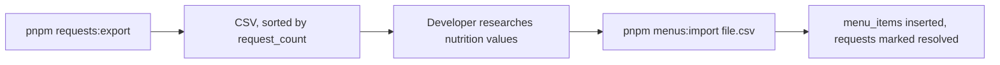

# Server Design

Cloudflare Worker (Hono + D1). Japanese version: [ServerDesign.ja.md](ServerDesign.ja.md)

## Responsibilities

1. Return chain menus entered by the developer.
2. Record not-found requests (merged and counted).
3. Relay product contributions to Open Food Facts with the shared app account (password kept as a Worker secret).

Clients never write menu data. The developer registers menus by hand.

## API (`/v1`, JSON, validated with Zod)

| Method | Path                     | Purpose                                                                          |
| ------ | ------------------------ | -------------------------------------------------------------------------------- |
| GET    | `/v1/chains`             | List chains                                                                      |
| GET    | `/v1/menus?chain=&q=`    | Search menu items                                                                |
| POST   | `/v1/menu-requests`      | Record a not-found request; returns `{requestId}`. Identical requests are merged |
| GET    | `/v1/menu-requests?ids=` | Status of requests; includes the menu item once resolved                         |
| POST   | `/v1/off/products`       | Relay a product contribution to OFF                                              |
| POST   | `/v1/off/images`         | Relay a product photo to OFF                                                     |

POST endpoints require the installation ID header and are rate limited.

## D1 Schema

| Table           | Columns                                                                                                                                                     |
| --------------- | ----------------------------------------------------------------------------------------------------------------------------------------------------------- |
| `chains`        | id, name, aliases                                                                                                                                           |
| `menu_items`    | id, chain_id, name, serving, nutrients, source_url, updated_at                                                                                              |
| `menu_requests` | id, chain_norm, menu_norm, raw_sample, request_count, status (open / resolved / rejected), resolved_menu_item_id, timestamps. UNIQUE(chain_norm, menu_norm) |
| `rate_limits`   | installation_hash, day, count                                                                                                                               |

Normalization (shared with the app): NFKC → lowercase → collapse whitespace.

## Rate Limiting

Daily cap per installation ID and per IP on POST endpoints. This is the main protection against spam and abuse of the OFF relay.

## Developer Batch Workflow (manual)

Automating this batch is a future option.

## Free Tier Notes

100k requests/day, 10 ms CPU per request (relaying is I/O-bound), 5 cron triggers per account (unused for now). D1 quotas must be confirmed before launch.
